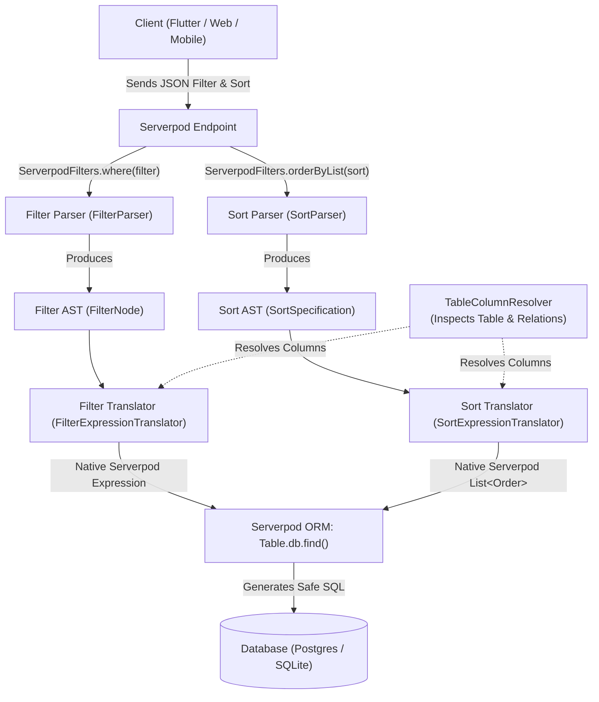

# serverpod_filters: Technical Architecture & Deep Dive Guide

Welcome to the internal technical documentation for `serverpod_filters`. This document provides a comprehensive, function-by-function guide explaining how the filtering and sorting engines work under the hood. It is designed to be accessible to developers of all experience levels—from beginners learning Serverpod ORM concepts to senior engineers optimizing backend query pipelines.

---

## Table of Contents

1. [High-Level Architecture & Pipeline](#1-high-level-architecture--pipeline)
2. [Shared Reflection Engine: `TableColumnResolver`](#2-shared-reflection-engine-tablecolumnresolver)
3. [The Advanced Filtering Engine](#3-the-advanced-filtering-engine)
   - [Filter AST Hierarchy](#filter-ast-hierarchy)
   - [Filter Parser (`FilterParser`)](#filter-parser-filterparser)
   - [Filter Expression Translator (`FilterExpressionTranslator`)](#filter-expression-translator-filterexpressiontranslator)
   - [Filter Operators Deep Dive](#filter-operators-deep-dive)
4. [The Advanced Sorting Engine](#4-the-advanced-sorting-engine)
   - [Standard Sorting Formats](#standard-sorting-formats)
   - [Sort AST Hierarchy](#sort-ast-hierarchy)
   - [Sort Parser (`SortParser`)](#sort-parser-sortparser)
   - [Sort Expression Translator (`SortExpressionTranslator`)](#sort-expression-translator-sortexpressiontranslator)
   - [Top-Level Facades (`ServerpodFilters` & `ServerpodSorting`)](#top-level-facades-serverpodfilters--serverpodsorting)
5. [End-to-End Execution Walkthrough](#5-end-to-end-execution-walkthrough)
6. [Security, Whitelisting & Error Handling](#6-security-whitelisting--error-handling)

---

## 1. High-Level Architecture & Pipeline

Traditional web and mobile applications need to filter and sort database tables dynamically based on user interaction (search bars, dropdowns, pagination tables, multi-column sorting). Normally, this requires either:
1. Writing custom, repetitive query methods for every combination of parameters, or
2. Manually writing raw SQL strings, which risks SQL injection and bypasses Serverpod's type-safety.

`serverpod_filters` solves this by introducing a **Compiler Pipeline**. It converts client-provided, JSON-serializable queries into native Serverpod ORM objects (`Expression` and `Order`).



### The Three Pipeline Stages

1. **Parsing (Syntax Analysis):** Validates the client input (strings, lists, or JSON), ensures identifiers contain no malicious SQL characters, and builds a strongly-typed Abstract Syntax Tree (AST).
2. **Resolution (Metadata Inspection):** Traverses the Serverpod `Table` descriptor at runtime. If the user specifies `customer.country.name`, the resolver looks up the `customer` relation table, followed by the `country` relation table, and finds the `name` column.
3. **Translation (ORM Compilation):** Translates the AST into native Serverpod `Expression`s (for WHERE clauses) and `Order` objects (for ORDER BY clauses).

---

## 2. Shared Reflection Engine: `TableColumnResolver`

Located in [`lib/src/resolver/table_column_resolver.dart`](file:///c:/Users/Lenovo/Documents/Development%20Projects/Flutter/serverpod_filters/serverpod_filters_server/lib/src/resolver/table_column_resolver.dart).

Serverpod generates strongly-typed `Table` classes for all models defined in `.spy.yaml` (e.g. `OrderTable`, `CustomerTable`). Every `Table` exposes:
- `table.columns`: A list of all database columns on that table.
- `table.getRelationTable(String relationFieldName)`: Returns the relation `Table` for foreign key relationships.

`TableColumnResolver` is responsible for inspecting these structures without requiring any manual YAML schemas or configuration files.

### Functions Defined

#### `Column resolveColumn(Table rootTable, String fieldPath)`
- **What it does:** Resolves any field path—including multi-hop dot-notation paths—starting from `rootTable` down to the target `Column`.
- **How it works step-by-step:**
  1. Splits `fieldPath` by `.` into segments (e.g., `'customer.country.code'` becomes `['customer', 'country', 'code']`).
  2. For all intermediate segments (`customer`, then `country`), it calls `currentTable.getRelationTable(segment)`.
  3. If a relation does not exist on that table, it throws an informative `ArgumentError` telling the developer which relation could not be found.
  4. Once it reaches the final segment (`code`), it iterates over `currentTable.columns` and calls `matchesColumn(...)`.
  5. Returns the matched `Column` instance.

#### `bool matchesColumn(Column col, String queryName)`
- **What it does:** Matches a column against the user's query name flexibly.
- **Why it matters:** Client applications often use `camelCase` (e.g. `customerId`), while database columns often use `snake_case` (e.g. `customer_id`).
- **How it works:**
  1. Checks for exact equality: `col.fieldName == queryName || col.columnName == queryName`.
  2. Normalizes both names by stripping underscores (`_`) and converting to lowercase.
  3. Returns `true` if normalized names match.

---

## 3. The Advanced Filtering Engine

### Filter AST Hierarchy

Located in [`lib/src/filters/ast/filter_node.dart`](file:///c:/Users/Lenovo/Documents/Development%20Projects/Flutter/serverpod_filters/serverpod_filters_server/lib/src/filters/ast/filter_node.dart).

All filter expressions are represented as an Abstract Syntax Tree (AST) rooted at `FilterNode`:

- **`FilterNode` (sealed class):** Base class for all filter nodes. Implements the Visitor pattern (`accept(...)`) and node simplification (`simplify()`).
- **`FilterCriterion`:** A leaf condition representing a single field comparison, e.g.:
  ```dart
  FilterCriterion(field: 'amount', operator: FilterOperator.greaterThan, value: 100.0)
  ```
  - `pathSegments`: Splits dot notation into segments.
  - `isRelational`: `true` if `field` contains `.`.
  - `rootField`: The first relation segment (e.g. `'customer'`).
  - `targetField`: The final column name (e.g. `'code'`).
- **`AndFilter`:** Represents a logical `AND` combinator containing a list of child nodes (`List<FilterNode>`).
- **`OrFilter`:** Represents a logical `OR` combinator containing a list of child nodes.
- **`NotFilter`:** Represents logical negation (`NOT`), wrapping a single child `FilterNode`.
- **`TrueFilter` & `FalseFilter`:** Represent constant boolean values `TRUE` and `FALSE` (used for empty filters or identity operands).

---

### Filter Parser (`FilterParser`)

Located in [`lib/src/filters/parser/filter_parser.dart`](file:///c:/Users/Lenovo/Documents/Development%20Projects/Flutter/serverpod_filters/serverpod_filters_server/lib/src/filters/parser/filter_parser.dart).

#### `FilterNode parse(dynamic rawFilter)`
- **What it does:** Converts any input (JSON string, Dart list, or `null`) into a validated `FilterNode` AST.
- **How it works:**
  1. If `rawFilter == null` or an empty list `[]`, returns `const TrueFilter()`.
  2. If `rawFilter is String`, parses it using `jsonDecode`.
  3. Creates a `_Cursor` over the token list.
  4. Parses criteria using Polish prefix notation (`&`, `|`, `!`) or sequential criteria.
  5. If multiple criteria are provided sequentially without explicit operators, wraps them in an implicit `AndFilter`.
  6. Calls `.simplify()` on the resulting tree (e.g., collapses `!(!A)` to `A`, eliminates identity truth conditions).

---

### Filter Expression Translator (`FilterExpressionTranslator`)

Located in [`lib/src/filters/translator/filter_expression_translator.dart`](file:///c:/Users/Lenovo/Documents/Development%20Projects/Flutter/serverpod_filters/serverpod_filters_server/lib/src/filters/translator/filter_expression_translator.dart).

#### `Expression translate(FilterNode node, Table table)`
Recursively pattern-matches on `node`:
- `FilterCriterion leaf` -> calls `_translateCriterion(leaf, table)`.
- `AndFilter andNode` -> joins child expressions using Serverpod's `&` operator.
- `OrFilter orNode` -> joins child expressions using Serverpod's `|` operator.
- `NotFilter notNode` -> negates the child expression using Serverpod's `~` operator.
- `TrueFilter` -> returns `Constant.bool(true)`.
- `FalseFilter` -> returns `Constant.bool(false)`.

---

### Filter Operators Deep Dive

| Operator Symbol | Description | Null Behavior | Generated Serverpod Method |
|---|---|---|---|
| `=` | Equality | If value is `null`, compiles to `IS NULL` | `column.equals(val)` / `column.isNull()` |
| `!=` | Inequality | If value is `null`, compiles to `IS NOT NULL` | `column.notEquals(val)` / `column.isNotNull()` |
| `>` | Greater Than | Requires non-null comparable | `column > val` |
| `>=` | Greater Than or Equal | Requires non-null comparable | `column >= val` |
| `<` | Less Than | Requires non-null comparable | `column < val` |
| `<=` | Less Than or Equal | Requires non-null comparable | `column <= val` |
| `in` | Set Inclusion | Accepts `List` or `Set` | `column.inSet(val.toSet())` |
| `not in` | Set Exclusion | Accepts `List` or `Set` | `column.notInSet(val.toSet())` |
| `like` | Pattern match (case-sensitive) | SQL LIKE wildcard (`%`) | `column.like(val)` |
| `ilike` | Pattern match (case-insensitive) | SQL ILIKE wildcard (`%`) | `column.ilike(val)` |
| `not like` | Negative pattern match | SQL NOT LIKE | `column.notLike(val)` |
| `not ilike` | Negative case-insensitive match | SQL NOT ILIKE | `column.notIlike(val)` |
| `=?` | Conditional Equality | If `val` is `null`, `false`, or `""`, evaluates to `TRUE` (no-op) | `column.equals(val)` or `Constant.bool(true)` |

---

## 4. The Advanced Sorting Engine

### Standard Sorting Formats

The sorting engine adopts a clean, standard specification:

1. **Standard 2-Element Tuple:**
   - Single column: `['amount', 'desc']` or `['createdAt', 'asc']`
   - Multi-column list: `[['customer.country.name', 'asc'], ['amount', 'desc']]`
2. **Standard Directional Strings:**
   - Prefixes: `'-amount'` *(descending)*, `'+amount'` or `'amount'` *(ascending)*
   - Suffixes: `'amount desc'`, `'createdAt asc'`
   - Comma-delimited: `'-amount, createdAt:asc, customer.name:desc'`
3. **Standard Structured Map (JSON:API / REST):**
   - Single: `{'field': 'amount', 'direction': 'desc'}`
   - Multi-column: `[{'field': 'customer.name', 'direction': 'asc'}, {'field': 'amount', 'direction': 'desc'}]`
   - Key-value map: `{'state': 'asc', 'amount': 'desc'}`

---

### Sort AST Hierarchy

Located in [`lib/src/sorting/ast/`](file:///c:/Users/Lenovo/Documents/Development%20Projects/Flutter/serverpod_filters/serverpod_filters_server/lib/src/sorting/ast/).

#### `SortDirection` enum
- `SortDirection.ascending`: Represents ascending order (`ASC`, `+`).
- `SortDirection.descending`: Represents descending order (`DESC`, `-`).
- `SortDirection.parse(dynamic value)`: Robust parser accepting booleans (`true` for descending), numeric values (`-1` for descending), and strings (`'asc'`, `'desc'`, `'ascending'`, `'descending'`).
- `reversed()`: Flips the direction.

#### `SortCriterion`
Represents an individual sort rule:
- `field`: The column name or relational dot path (e.g. `'customer.country.name'`).
- `direction`: The `SortDirection`.
- `reversed()`: Returns a copy with inverted direction.
- `toJson()`: Serializes to a standard Map (`{'field': field, 'direction': direction.name}`).

#### `SortSpecification`
Represents the ordered list of criteria:
- Implements `Iterable<SortCriterion>`.
- `hasField(String field)`: Case-insensitive check if a field is being sorted on.
- `findCriterion(String field)`: Returns the criterion for that field, if present.
- `reversed()`: Reverses the sort directions for all criteria in the specification.
- `filterAllowed(Set<String> allowedFields, {bool strict = false})`: Whitelists allowed columns. If `strict: true`, throws `SortValidationException` if an unapproved field is present.
- `withFieldMap(Map<String, String> fieldMap)`: Translates client-facing field names (e.g. `'created'`) to underlying database paths (e.g. `'createdAt'`).

---

### Sort Parser (`SortParser`)

Located in [`lib/src/sorting/parser/sort_parser.dart`](file:///c:/Users/Lenovo/Documents/Development%20Projects/Flutter/serverpod_filters/serverpod_filters_server/lib/src/sorting/parser/sort_parser.dart).

#### `SortSpecification parse(dynamic rawSort)`
- **Step 1: Null & Empty Checks:** Returns `SortSpecification.empty()` for `null`, `""`, `[]`, or `{}`.
- **Step 2: JSON Decoding:** If the input is a String starting with `[`, `{`, or `"`, attempts to decode it with `jsonDecode` and re-enters `parse` with the decoded structure.
- **Step 3: String Parsing:**
  - If the string contains commas (`,`), splits into segments and parses each.
  - Checks for `-` prefix (descending) or `+` prefix (ascending).
  - Checks for `:` or `/` delimiters (`amount:desc`).
  - Checks for whitespace separation (`amount desc`).
  - Validates field names against identifier regex (`^[a-zA-Z_][a-zA-Z0-9_]*(\.[a-zA-Z_][a-zA-Z0-9_]*)*$`) to guarantee SQL injection immunity.
- **Step 4: List Parsing:**
  - If the list is a 2-element tuple where the second element is a direction indicator (`['amount', 'desc']` or `['amount', -1]`), treats it as a single criterion.
  - If it is a list of items, parses each element (nested tuple, string, or map).
- **Step 5: Map Parsing:**
  - Looks for standard keys: `'field'`, `'selector'`, `'column'`, `'colId'`, `'id'`, `'name'`.
  - Determines direction from `'desc'`, `'descending'`, `'isDescending'`, `'asc'`, `'direction'`, or `'order'`.
  - If no metadata keys are present, treats the map as a key-value dictionary `{fieldName: direction}`.

---

### Sort Expression Translator (`SortExpressionTranslator`)

Located in [`lib/src/sorting/translator/sort_expression_translator.dart`](file:///c:/Users/Lenovo/Documents/Development%20Projects/Flutter/serverpod_filters/serverpod_filters_server/lib/src/sorting/translator/sort_expression_translator.dart).

#### `List<Order> translate(SortSpecification spec, Table table, {Set<String>? allowedFields, Map<String, String>? fieldMap, bool strict = false})`
- **Step 1:** Applies `fieldMap` if provided to remap client alias names.
- **Step 2:** Applies `allowedFields` whitelisting if provided.
- **Step 3:** For each criterion:
  1. Resolves the column from `table` via `columnResolver.resolveColumn(table, criterion.field)`.
  2. If `direction == SortDirection.ascending`, calls `column.asc()`.
  3. If `direction == SortDirection.descending`, calls `column.desc()`.
- **Step 4:** Returns `List<Order>`.

---

### Top-Level Facades (`ServerpodFilters` & `ServerpodSorting`)

Both facades provide an intuitive, high-level API for Serverpod endpoints.

#### `ServerpodFilters.orderByList(sort, {defaultSort, allowedFields, fieldMap, strict})`
- Returns a Serverpod-compatible `OrderByListBuilder<T>?` callback: `(T table) => List<Order>`.
- Returns `null` if the resolved sort is empty and no `defaultSort` was supplied.
- Allows chaining with Dart's `??` operator:
  ```dart
  orderByList: ServerpodFilters.orderByList(sort) ?? ((t) => [t.id.desc()])
  ```

#### `ServerpodFilters.toOrderByList(sort, table, ...)`
Directly returns `List<Order>` for a given table instance.

---

## 5. End-to-End Execution Walkthrough

Let us trace what happens when a client sends this request:

```json
{
  "filter": ["&", ["amount", ">=", 150.0], ["customer.country.code", "=", "US"]],
  "sort": "-amount, customer.name:asc"
}
```

### In Your Endpoint

```dart
class OrderEndpoint extends Endpoint {
  Future<List<Order>> listOrders(Session session, {dynamic filter, dynamic sort}) async {
    return await Order.db.find(
      session,
      where: ServerpodFilters.where(filter),
      orderByList: ServerpodFilters.orderByList(sort),
    );
  }
}
```

### What Happens Internally

1. **`ServerpodFilters.where(filter)`:**
   - Returns a callback `(OrderTable t) => ServerpodFilters.toWhere(filter, t)`.
   - Serverpod calls this callback with the table descriptor `Order.t`.
   - `FilterParser` parses the prefix Polish array:
     - `AndFilter([FilterCriterion('amount', '>=', 150.0), FilterCriterion('customer.country.code', '=', 'US')])`
   - `FilterExpressionTranslator` translates this:
     - Resolves `amount` on `OrderTable` -> `order.amount >= 150.0`.
     - Resolves `customer.country.code` -> traverses `OrderTable.customer` relation, then `CustomerTable.country` relation -> `country.code.equals('US')`.
     - Combines them using `&`.
   - Result: Native Serverpod `Expression`.

2. **`ServerpodFilters.orderByList(sort)`:**
   - Returns an `OrderByListBuilder<OrderTable>` callback: `(OrderTable t) => [...]`.
   - `SortParser` parses `"-amount, customer.name:asc"` into:
     - `SortSpecification([SortCriterion('amount', descending), SortCriterion('customer.name', ascending)])`.
   - `SortExpressionTranslator` translates each criterion:
     - `amount` on `OrderTable` -> `order.amount.desc()`.
     - `customer.name` -> traverses `OrderTable.customer` -> `customer.name.asc()`.
   - Result: `List<Order>`.

3. **Serverpod Database Query Generation:**
   - Serverpod sees `where` and `orderByList` targeting related tables (`customer`, `country`).
   - Serverpod automatically injects the necessary `LEFT JOIN`s into the SQL query:
     ```sql
     SELECT "order".*
     FROM "order"
     LEFT JOIN "customer" AS "order_customer_customer" ON "order"."customer_id" = "order_customer_customer"."id"
     LEFT JOIN "country" AS "order_customer_customer_country_country" ON "order_customer_customer"."country_id" = "order_customer_customer_country_country"."id"
     WHERE "order"."amount" >= 150.0 AND "order_customer_customer_country_country"."code" = 'US'
     ORDER BY "order"."amount" DESC NULLS FIRST, "order_customer_customer"."name" ASC NULLS LAST;
     ```

---

## 6. Security, Whitelisting & Error Handling

### 1. SQL Injection Prevention
All field identifiers are validated with regular expressions before any resolution takes place. Operators and sorting directions are strictly constrained to fixed enums (`FilterOperator`, `SortDirection`). Values are bound using Serverpod's prepared statement encoders (`PostgresValueEncoder` / `SqliteValueEncoder`), guaranteeing that SQL injection attacks are structurally impossible.

### 2. Whitelist Security
To protect private database fields (e.g., `passwordHash`, `internalAuditStatus`):
```dart
ServerpodFilters.orderByList(
  clientSort,
  allowedFields: {'id', 'createdAt', 'amount', 'customer.name'},
  strict: true, // If true, throws SortValidationException when client tries to sort by unauthorized fields
)
```

### 3. Clear Exception Hierarchy
- **`FilterParseException`**: Thrown when filter syntax is malformed (e.g. missing operand for `&`, invalid operator).
- **`SortParseException`**: Thrown when sort syntax is invalid (e.g. unknown direction, invalid characters).
- **`SortValidationException`**: Thrown when a field violates security whitelist rules.
- **`ArgumentError`**: Thrown if a requested relation or column does not exist on the Serverpod `Table`.
